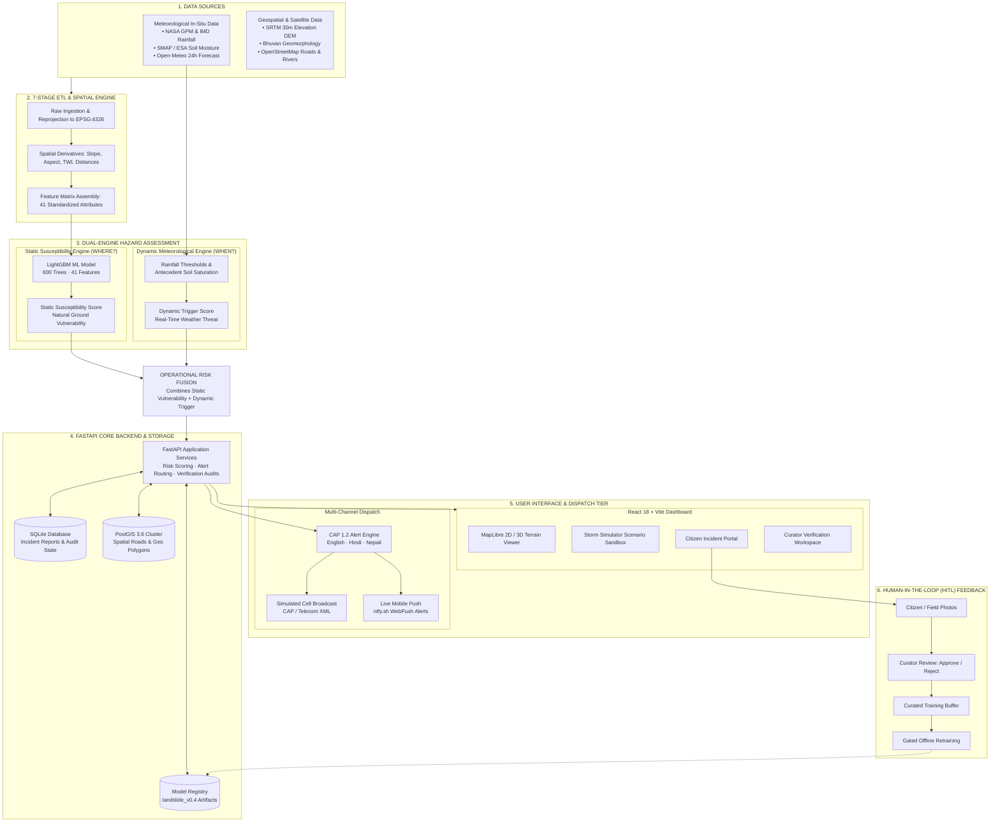

# TerraPulse.ai — System Architecture & Implementation Guide

**Project:** TerraPulse.ai (SIH26001 — AI-Based Early Warning & Landslide Risk Monitoring)  
**Document Purpose:** Complete Architecture Reference, Mermaid Flowcharts, Evaluator Explanations, and Defense Script.  
**Architecture Diagram Image:** [`model_graphs/system_architecture_diagram.png`](model_graphs/system_architecture_diagram.png)

---

## 1. Visual System Architecture Diagram (Mermaid)

---

## 2. Simple Explanation: Susceptibility vs. Dynamic Engine

If your madam or jury asks: **"What is the difference between Susceptibility and the Dynamic Meteorological Engine?"**

Explain it with this real-world gun analogy:

| Feature | Static Susceptibility Engine | Dynamic Meteorological Engine |
| :--- | :--- | :--- |
| **Real Meaning** | **Natural Vulnerability** of the land. | **Immediate Weather Trigger** happening now. |
| **Simple Analogy** | The **Loaded Gun** (it is inherently dangerous, even if unfired). | **Pulling the Trigger** (the action that causes the shot). |
| **Does it change?**| **No.** It stays constant week to week (slope angle, rock type, distance from road). | **Yes.** Changes hour by hour (rainfall intensity, accumulated rain, soil moisture). |
| **Input Data** | SRTM DEM (slope, elevation, TWI), soil composition, distance to fault line, road cutting. | 1h/24h rainfall, antecedent 3-day rainfall, SMAP soil saturation, weather forecast. |
| **Core Technology**| **Trained LightGBM Machine Learning Model** (41 features). | **Empirical Rainfall Thresholds & Antecedent Saturation Logic**. |
| **Question Answered**| **"WHERE is the ground naturally prone to collapsing?"** | **"IS the current weather dangerous enough to cause a failure right now?"** |

### Operational Risk Fusion:
* A flat playground with heavy rainfall will not slide.
* A steep, unstable cliff on a dry sunny winter day will not slide.
* **A landslide only occurs when the land is naturally vulnerable (High Susceptibility) AND heavy rain arrives (High Dynamic Trigger).** TerraPulse fuses both to calculate the actual operational risk:
$$R_{\text{op}} = \min(1.0, \, \max(S_{\text{static}}, T_{\text{dynamic}}) \cdot [1 + \alpha \cdot S \cdot T])$$

---

## 3. Simple Explanation: What is Multi-Channel Dispatch?

If they ask: **"What is Multi-Channel Dispatch and how does it work?"**

**Answer in 4 simple points:**
1. **Definition:** When high or critical risk is detected, the system cannot rely on only one communication method. Multi-channel dispatch means broadcasting emergency warnings through multiple networks simultaneously so everyone receives it.
2. **Standard Protocol (CAP 1.2):** We format all alerts into **Common Alerting Protocol (CAP 1.2)** — the international XML/JSON emergency standard used by disaster authorities (like NDMA / SACHET).
3. **Trilingual Localization:** The alert message is automatically prepared in:
   * **English** (for administrative officers and state disaster teams).
   * **Hindi** (for national disaster relief forces).
   * **Nepali** (for local hill communities and transport drivers along the Sikkim / Nepal corridor).
4. **The Channels Deployed:**
   * **Cell Broadcast (Simulated):** Formats geo-fenced cell tower alert payloads ready for telecom integration without needing internet connectivity.
   * **Mobile Push Notification (ntfy.sh):** Sends instant real-time emergency notifications directly to smartphones and field tablets during live operations.

---

## 4. 60-Second Speech for Your Presentation

> *"Respected Madam and evaluators, TerraPulse AI solves the landslide problem by decoupling **where** the ground is dangerous from **when** it will fail.*
> 
> *Our **Static Susceptibility Engine** uses a trained **LightGBM model with 41 terrain and geological features** to evaluate the inherent vulnerability of the slope.*
> 
> *Our **Dynamic Meteorological Engine** continuously monitors live rainfall, 24-hour forecasts, and soil saturation to detect active failure triggers.*
> 
> *When both align, our **FastAPI backend** fuses the scores, plots the risk in real-time on our **MapLibre 3D terrain**, and triggers **Multi-Channel CAP 1.2 alerts** in English, Hindi, and Nepali via Cell Broadcast and mobile push.*
> 
> *Finally, crowdsourced citizen reports pass through our **Human-in-the-Loop Curator** to ensure verified ground evidence feeds safe, offline model retraining."*

